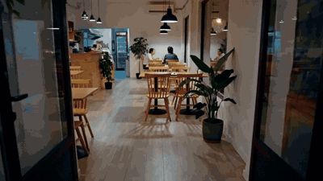

# Casa Tempero

A demo website for a **fictional** Brazilian restaurant, built around two scroll-driven video scenes. As you scroll, the camera walks into the restaurant, sits at a table and opens the menu, and the paper in the video turns into the site's actual menu. Further down, a second scene builds the house dish, a *Prato Feito*, ingredient by ingredient, with each step explained as it lands on the plate.



**Live demo:** https://davi-webdev.github.io/casa-tempero/

> Casa Tempero is not a real restaurant. The name, dishes, prices, address and phone number are all placeholders.

## Highlights

- **Two scroll-driven scenes**, rendered frame by frame on a `<canvas>` (362 + 192 frames at 24 fps on desktop)
- **Seamless hand-off from video to page**: the intro ends on the menu paper, and the menu section starts in that exact colour
- **Labels that track objects inside the video**, positioned from keyframed coordinates and mapped through the same `cover` crop as the canvas
- **Step-by-step dish breakdown** synced to the video: each ingredient lights up its step the moment it appears on the plate
- **Frame blending**: fractional scroll positions mix neighbouring frames, so the image changes continuously instead of stepping, even on the 12 fps mobile set
- **Separate mobile assets**: a portrait crop of the intro at the same sharpness as desktop and a 960x540 cut of the plate, at 12 fps and packed four frames per file. Half the frames of the desktop set keeps decoded image memory within what iOS Safari tolerates, low enough for iOS Safari not to evict and re-decode frames mid-scroll
- **Automatic quality fallback**: while the user scrolls, `main.js` samples frame times; if a device keeps dropping below ~35 fps, both scenes switch to a 1x canvas
- **No canvas thrashing on iOS**: the canvas is only resized when its pixel size actually changes, so Safari's collapsing address bar doesn't clear it while scrolling
- **Coarse-to-fine loading**: the whole video becomes scrubbable early and fills in as the rest downloads; the second scene loads in the background
- **No work when idle**: a single `requestAnimationFrame` loop only redraws a scene when its progress changes
- **Accessible defaults**: semantic HTML, keyboard focus styles and a static fallback for `prefers-reduced-motion`
- **Plain HTML, CSS and JavaScript**: no frameworks, no libraries, no build step

## How it works

1. Each video is exported as WebP frames with `ffmpeg` and packed into sprite sheets (2 frames per file on desktop, 4 on mobile).
2. Each scene is a tall `<section>` with a `position: sticky` stage inside it.
3. `ScrollScene` measures how far the section has been scrolled (0 to 1) and eases toward that value every frame.
4. `FrameSequence` maps that progress to a frame and draws it, cropping like `object-fit: cover`.
5. Each scene's `render()` uses the same progress to drive text, labels, steps and transitions.S

## Project structure

```
casa-tempero/
├── index.html
├── css/
│   ├── base.css            design tokens, reset, top bar, footer
│   ├── intro.css           scene 1: walking in
│   ├── plate.css           scene 2: the dish being built
│   └── sections.css        menu, about, booking
├── js/
│   ├── frame-sequence.js   loads sprite sheets and draws frames
│   ├── scroll-scene.js     scroll progress, easing and the render loop
│   ├── intro.js            scene 1 timeline, copy and labels
│   ├── plate.js            scene 2 timeline and steps
│   └── main.js             wiring and loading order
├── assets/
│   ├── intro/desktop/      1280x720 frames, 2 per file
│   ├── intro/mobile/       405x720 portrait crop, 12 fps, 4 per file
│   ├── plate/desktop/      1280x720 frames, 2 per file
│   └── plate/mobile/       960x540 frames, 12 fps, 4 per file
└── docs/preview.gif
```

## Run locally

The frames are loaded with JavaScript, so serve the folder instead of opening the file directly:

```
python -m http.server
```

Then open `http://localhost:8000`. In VS Code, the **Live Server** extension works too.

## Replacing a video

```
# desktop: 2 frames per file
ffmpeg -i video.mp4 -vf "scale=1280:720,unsharp=5:5:0.6,tile=2x1" -an -c:v libwebp -quality 90 -start_number 1 assets/intro/desktop/%03d.webp

# mobile: centre portrait crop at 12 fps, 4 frames per file
ffmpeg -i video.mp4 -vf "fps=12,crop=ih*9/16:ih,scale=405:720,unsharp=5:5:0.6,tile=4x1" -an -c:v libwebp -quality 90 -start_number 1 assets/intro/mobile/%03d.webp
```

Then update `total` in `js/intro.js` (or `js/plate.js`) with the new frame count.

## Credits

- Intro footage generated with [Hailuo AI](https://hailuoai.video); plate footage generated with Google Flow (Veo 3.1)
- Fonts: [Bricolage Grotesque](https://fonts.google.com/specimen/Bricolage+Grotesque) and [Figtree](https://fonts.google.com/specimen/Figtree)
- Designed and built by **Davi**

## License

Code released under the [MIT License](LICENSE).
